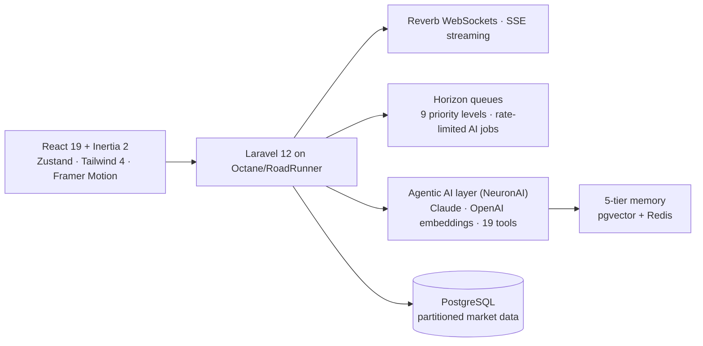

# SpectroTS — AI trading education platform

> **Showcase repository.** The source code is private; this page documents what the platform does and how it was built.
> Built by [Roderick Specter](https://github.com/rodcoding123).

SpectroTS is an AI-powered trading education platform: realistic trading simulation, an AI coach with long-term memory, and gamified progression, in one product. The first full version was built **solo in five days** using an autonomous Claude Code build loop.

---

## At a glance

| | |
|---|---|
| **Initial build** | 5 days, solo, autonomous agent loop |
| **Backend** | 630+ PHP files: 86 models, 81 controllers, 237 services, 55 AI services |
| **Frontend** | 400+ TypeScript/React files: 91 pages, 233 components, 12 stores |
| **Database** | 83+ PostgreSQL tables, pgvector, partitioned OHLCV time series |
| **Tests** | 130+ test files (PHPUnit, Vitest, Playwright) plus Storybook |

---

## Features

- **Trading simulator** with professional charts (TradingView Lightweight Charts) and real-time updates over WebSockets
- **Screener, portfolio and research** modules
- **AI coach** with 19 specialized tools (prices, indicators, journaling, risk, education)
- **Five-tier cognitive memory** for the coach:
  1. Core memory: profile, trading style, risk tolerance
  2. Episodic memory: past conversations and trading events (vector search)
  3. Semantic memory: learned facts and patterns, with confidence decay
  4. Procedural memory: personal rules, checklists, entry and exit criteria
  5. Working memory: current session state (Redis, 24h TTL)
- **Curriculum and training** with gamified progression

---

## Architecture

## Tech stack

| Layer | Technology |
|---|---|
| Backend | Laravel 12, PHP 8.2 strict types, Octane + RoadRunner, Reverb, Horizon |
| Frontend | React 19, TypeScript 5.9, Inertia 2, Vite 7, Tailwind 4, Zustand 5 |
| Data viz | TradingView Lightweight Charts, Recharts |
| AI | Anthropic Claude, OpenAI embeddings, NeuronAI, pgvector |
| Quality | PHPUnit 11, Vitest 4, Playwright, Storybook 10, PHPStan, Pint, ESLint, Husky |
| Monitoring | Inspector APM, Telescope, Pail |

---

## What this project shows

- How far an AI-native, agent-driven build process can go in days
- Designing agent memory beyond simple chat history
- Real-time, data-heavy UX on a modern Laravel + React stack

---

Reach me through my [GitHub profile](https://github.com/rodcoding123) or Upwork.
